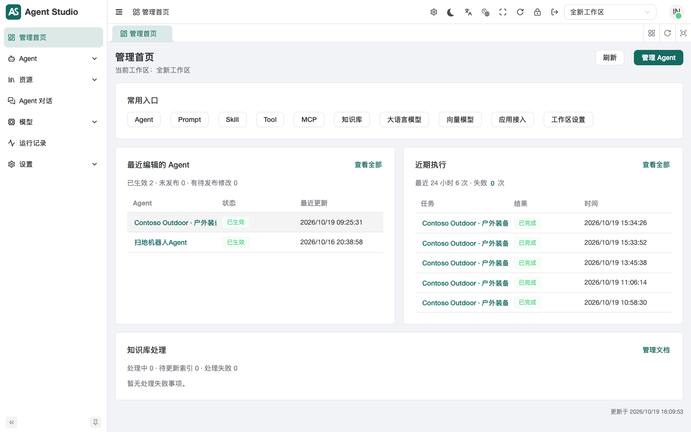

# Agent Studio

**构建、发布并运行通用 Agent 的开源平台。** 在一个工作区管理模型、Prompt、Skill、知识库和工具，让同一套执行能力可以通过后台聊天和 API 接入不同应用。

[在线应用体验](https://hexu.7410000.xyz/) · [独立展示站 Demo Hub](https://github.com/chaobin0701/demo-hub) · [部署说明](deploy/showcase/README.md)

Agent Studio 负责资源版本、权限和执行；业务系统继续拥有自己的数据。扫地机器人和户外装备顾问是由独立 Demo Hub 接入的示例应用，不是平台内置业务流程。

## 项目亮点

| 核心亮点 | 说明 |
| --- | --- |
| 通用 Agent 平台 | 在工作区统一管理 Agent、模型方案、业务 Prompt、Skill、Tool 和知识库，并通过聊天或独立任务接口接入不同应用。业务数据由外部服务提供。 |
| ReAct 式执行链 | 基于 Deep Agents / LangChain / LangGraph 完成模型决策、工具调用、结果反馈与继续推理；Chat 和 Run 使用同一执行服务。平台在执行前固定授权和预算，在执行中记录调用过程。 |
| RAG 知识库闭环 | 文档上传后由 Worker 解析、分块并建立索引。支持 PostgreSQL 全文检索、pgvector 向量检索和混合检索，以 RRF 融合召回结果，并保留回答引用及索引版本。 |
| 可复用 Skill | 将已发布的 Skill 指导与辅助资料绑定到 Agent，运行时作为只读虚拟文件按需读取；Skill 版本进入任务快照，不因资料内容获得额外工具权限。 |
| HTTP / MCP 工具接入 | 管理 HTTP Tool 与远程 Streamable HTTP MCP 连接。工具经过契约发现、测试、发布和 Agent 授权；执行时校验参数、凭据、网络边界及调用预算。 |
| 提问与工具审批 | 单 Agent 可暂停并请求用户选项或自由回答；需要审批的工具在调用前展示确认卡片。原生 LangGraph 检查点持久化到 PostgreSQL，答复后继续原任务，保留版本、用量与归属。 |
| 多 Agent 协作 | 入口 Agent 可委派给已授权的成员 Agent。成员使用各自发布的模型、Prompt 和能力，执行次数、Token 与期限受共同预算约束。 |
| 不可变发布快照 | 草稿可持续编辑；发布后固定 Agent 及其依赖版本。每次请求读取生效快照，历史版本、引用和运行记录可追溯。 |
| 接入与运行治理 | 支持后台调试、访客聊天、应用 API 和独立 Run；工作区权限与 PostgreSQL RLS 隔离数据，提供 SSE 流式输出、用量记录及可选的本地 Phoenix 追踪。 |

## 后台预览



本地示例工作区的管理首页集中呈现资源入口、最近编辑的 Agent、执行情况和知识库处理状态。

## 技术栈

| 层 | 技术 |
| --- | --- |
| 管理后台与共享聊天 UI | Vue 3、Vben Admin、Element Plus、Vite |
| API 与 Agent 执行 | Node.js、TypeScript、NestJS、Deep Agents、LangChain、LangGraph |
| 知识检索与持久化 | PostgreSQL 全文索引、pgvector、版本化索引 |
| 异步文档任务 | pg-boss、独立 Worker |
| 外部能力与传输 | HTTP Tool、MCP Streamable HTTP、SSE |

仓库按管理后台、服务端和共享 UI / 输出规范组织；详细模块位于 `admin-vben/`、`server/` 与 `packages/`。

## 本地启动

需要 Node.js 22.18+ 或 24.12+、pnpm 11+ 和 Docker Compose。模型调用需要自行配置供应商连接及密钥；仓库不提供默认管理员或可用的模型凭据。

```sh
npm run setup                  # 安装依赖；首次生成独立随机密钥的 .env
docker compose up -d postgres
npm run db:migrate
npm --prefix server run build
npm run admin:bootstrap         # 交互创建首个管理员
npm run dev
```

默认地址：管理后台 `http://localhost:8085`、API `http://localhost:3020`，PostgreSQL 本机端口 `5437`。首次登录后，先配置供应商连接与模型方案，再创建并发布 Prompt 和 Agent；需要对外聊天时，在后台创建接入应用，绑定已发布 Agent 并设置允许的 Origin。Agent 管理页的“试运行”进入独立任务页面；草稿试运行固定当前已保存修订。

外部聊天界面可通过接入应用调用平台 API；Demo Hub 是独立项目中的示例。应用 ID 是公开标识，浏览器使用服务端签发的短期访客令牌，**不能放入平台 API Key**。测试和启动不会自动启用应用或扩大 Origin。

需要交互式提问时，在工具管理创建并测试、发布内置 `ask_user`，再绑定到单 Agent；需要审批时开启相应工具的“调用前需批准”，按现有版本流程发布。后台聊天与 Demo Hub 均支持卡片、刷新恢复及历史查看。配置方式、API 与支持边界见[补充信息与工具审批](docs/human-interactions.md)。

## 验证与部署

```sh
npm run typecheck
npm run build
npm test
```

PostgreSQL 集成测试需显式配置 `TEST_DATABASE_URL`，使用临时 schema 并在结束后清理，不使用业务数据库。单独生产部署见 `compose.production.yml`；Agent Studio 与 Demo Hub 同机部署、备份和回滚见[展示环境手册](deploy/showcase/README.md)。首次全新生产部署使用 `admin:bootstrap` 创建管理员，不复用开发库账户。

仓库不包含原业务数据库、演示用户、上传文件、供应商密钥或聊天记录。业务系统通过 HTTP / MCP 接入；展示站和平台不共享业务数据库或执行内核。来源与第三方许可见 [SOURCE.md](SOURCE.md)，项目代码采用 [MIT 许可](LICENSE)。
