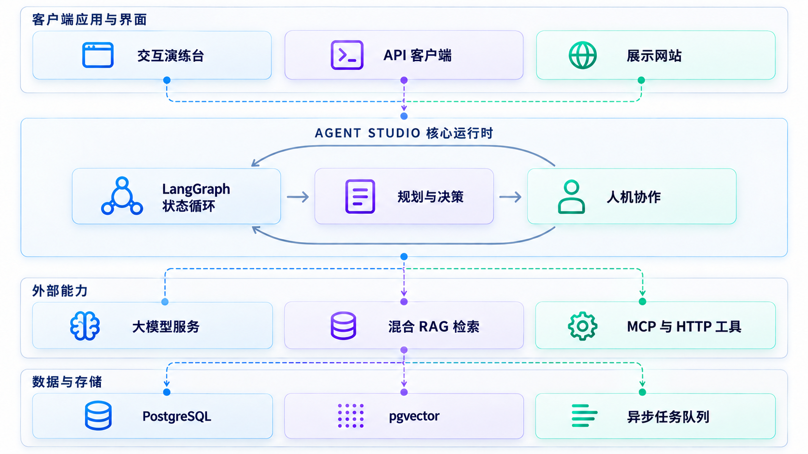

# Agent Studio

**企业级通用智能体 (Agent) 编排与运行平台。**

在一个统一的工作区中管理模型方案、业务 Prompt、可复用 Skill、知识库与外部工具，让具备自主决策能力的智能体能够安全、可靠地发布，并通过统一的聊天接口或 API 接入各类终端应用。

[English](README_EN.md) · [简体中文](README.md) · [在线应用体验](https://hexu.7410000.xyz/) · [官方展示站 (Agent Studio Showcase)](https://github.com/chaobin0701/agent-studio-showcase)

---

## 核心设计理念

Agent Studio 遵循三项核心设计原则，以应对企业级 AI 应用在生产环境中面临的不确定性与高耦合痛点：

1. **不可变发布快照 (Immutable Versioned Releases)**：草稿持续演进，发布严格固定。Agent 发布时会将自身配置及所依赖的 Prompt、模型方案、知识库和工具版本锁定为唯一快照。生产调用永远运行在确定性的快照之上，确保不可篡改、全链路可追溯，并支持一键无损回退。
2. **执行内核与业务领域彻底解耦**：Agent Studio 专注于 Agent 的认知编排、多轮推理、状态流转与安全治理；它不侵入任何具体业务数据。业务系统的数据资产通过标准化的 **HTTP Tool** 或 **Model Context Protocol (MCP)** 服务独立接入。
3. **真实的人机协作闭环 (Human-in-the-Loop)**：智能体在长任务执行中如果遇到信息缺失或敏感操作，可以随时挂起执行，向前台下发澄清选项或审批请求；在用户完成交互后，依托底层检查点机制精准恢复原任务继续执行。

---

## 系统架构与执行模型

Agent Studio 由**资产编排层**、**状态执行引擎**与**外部接入网关**构成完整的生产级闭环：



---

## 核心能力与设计亮点

### 1. 资产解耦与不可变版本控制
* **资产原子化**：模型方案 (Model Providers)、业务 Prompt、知识库 (Knowledge)、工具 (HTTP / MCP) 以及技能 (Skills) 均为独立受管的一等公民。
* **发布即快照**：支持多版本共存与版本差异比对（Diff）。发布时捕获所有依赖的 Hash，回滚时不影响历史任务记录与审计追踪。

### 2. Deep Agents / LangGraph 状态图引擎
* **双模态统一内核**：即时对话（Chat）与长生命周期任务（Run）复用相同的执行服务，具备严格的调用步数上限、全局 Token 预算与超时防卡死保护。
* **结构化输出保证**：支持基于 JSON Schema 的输出规范约束，提供字段树形编辑器与源码双视图，确保 Agent 严格返回下游系统所需的确定性数据结构。

### 3. 人机协作闭环 (Human-in-the-Loop)
* **主动提问 (`ask_user`)**：Agent 遇到模糊输入或决策分支时，主动发起交互并提供选项，前台即刻接管输入框并渲染交互卡片。
* **工具执行前审批**：对于订单修改、数据删除或隐私查询等高危工具，可开启“调用前需批准”；用户在界面确认后方可触发真实调用。
* **无损恢复机制**：执行状态由 PostgreSQL 检查点严格持久化，即便刷新浏览器或客户端临时断网，重新连接即可恢复待处理交互，不重复执行已有计算。

### 4. 工业级混合 RAG 检索闭环
* **混合多路召回**：文档上传后由独立 Worker 异步进行分块与解析；查询时结合 PostgreSQL 全文检索与 pgvector 向量检索，通过 RRF (Reciprocal Rank Fusion) 倒数排名融合算法智能重排。
* **来源溯源与版本隔离**：检索结果自带可核验的文件引用切片；知识库索引按版本隔离，老版本 Agent 锁定旧索引，新更新不破坏历史结论。

### 5. 开放工具生态：HTTP Tool 与标准 MCP 协议
* **原生支持 Model Context Protocol**：支持一键连接远程 Streamable HTTP MCP 端点，完成契约自发现与工具挂载。
* **企业级安全边界**：内置出口网络白名单校验、凭证引用加密存储、请求超时熔断与参数级校验，严防私网探针与凭据泄露。

### 6. 多租户治理与全链路观测
* **工作区与权限**：基于 PostgreSQL 行级安全 (RLS) 隔离工作区数据，细粒度 RBAC 权限控制到单项资产的读写与发布。
* **流式传输与可观测性**：基于标准 SSE 协议输出打字流与思维过程；全链路适配 OpenInference 规范，支持本地 Phoenix 追踪调用图谱与延迟瓶颈。

---

## 管理后台概览


基于 Vue 3 与 Tailwind CSS 构建的企业级管理控制台，提供从模型接入、Prompt 调优、知识库管理到可视化版本发布与独立试运行（Playground）的全生命周期管理。

---

## 快速上手

### 环境依赖
* **Node.js**：`>= 22.18` 或 `>= 24.12`
* **包管理器**：`pnpm >= 10.0.0`
* **容器环境**：Docker & Docker Compose（用于运行 PostgreSQL 及 pgvector 扩展）

### 本地部署运行

1. **安装工作区依赖并生成本地配置**：
   ```sh
   npm run setup
   ```
   *该脚本会自动检查环境并生成包含独立随机安全密钥的 `.env` 文件。*

2. **启动数据库服务**：
   ```sh
   docker compose up -d postgres
   ```

3. **执行数据库迁移**：
   ```sh
   npm run db:migrate
   ```

4. **编译后端核心代码**：
   ```sh
   npm --prefix server run build
   ```

5. **初始化首个管理员账户**：
   ```sh
   npm run admin:bootstrap
   ```
   *根据终端提示输入管理员邮箱、用户名与初始密码。*

6. **启动开发环境**：
   ```sh
   npm run dev
   ```

启动成功后：
* **管理控制台**：`http://localhost:8085`
* **平台 API 服务**：`http://localhost:3020`
* **PostgreSQL 端口**：`localhost:5437`

---

## 3 步构建你的第一个 Agent

进入管理后台登录后，只需三步即可完成一个受控 Agent 的构建与接入：

1. **配置模型提供商**：进入「模型管理」➔ 接入任意兼容 OpenAI 接口规范的供应商（如 DeepSeek、OpenAI、Ollama 等），创建默认模型方案。
2. **编排并发布版本**：
   * 在「Prompt 管理」中编写系统提示词；
   * 在「知识库」或「工具管理」中挂载外部数据或 MCP 服务；
   * 进入「Agent 管理」新建 Agent，组装上述资产并设置输入/输出规范，点击「发布」生成版本 1 快照。
3. **试运行与对外接入**：
   * 点击 Agent 旁边的 **「试运行」**，在独立任务界面验证思考链、工具调用与交互卡片；
   * 进入「应用管理」创建客户端应用，绑定已发布 Agent 并配置允许的域名，即可获取安全的公开接入凭证供业务前端调用。

---

## 项目代码结构

仓库采用 Monorepo 架构进行清晰的分层治理：

```text
agent-studio/
├── admin-vben/             # 管理后台前端工程 (Vue 3 / Vite / Vben Admin)
│   └── apps/web-ele/       # 基于 Element Plus 的管理应用与试运行页面
├── server/                 # 平台核心后端服务 (NestJS / TypeScript)
│   ├── src/ai/             # Agent 运行时、LangGraph 状态图、MCP 客户端与模型调度
│   ├── src/knowledge/      # RAG 混合检索、向量存储与切片服务
│   ├── src/tools/          # HTTP Tool 与 MCP 动态工具治理
│   └── src/admin/          # 工作区、用户、权限与应用鉴权 API
├── packages/               # 跨端共享代码包
│   ├── chat-ui/            # 跨端共用的现代聊天与交互卡片组件库
│   └── output-contract/    # 结构化输出 JSON Schema 校验与编辑器内核
└── deploy/                 # 容器化与生产展示环境部署配置
```

---

## 生态项目与最佳实践

为了演示平台如何在真实业务中做到“通用内核、业务解耦”，我们配套开源了独立的业务展示项目：

* **[Agent Studio Showcase (官方展示站)](https://github.com/chaobin0701/agent-studio-showcase)**：
  基于 Next.js 16 与 React 19 构建，包含两个端到端的完整业务场景：
  * **扫地机器人智能助理**：演示知识库排障、清洁分析报告与天气工具的混合调用。
  * **户外装备顾问 (Contoso Outdoor)**：演示零售导购、装备说明书检索，以及人机交互澄清与敏感购买记录查询审批。

---

## 验证与测试

```sh
npm run typecheck    # 全工作区 TypeScript 类型检查
npm run build        # 服务端与前端全量生产构建
npm test             # 运行全量单元与集成测试套件 (130+ 自动化用例)
```

---

## 开源协议与第三方声明

本项目代码基于 [MIT 许可证](LICENSE) 开源。第三方依赖与开源组件许可说明参见 [SOURCE.md](SOURCE.md)。
