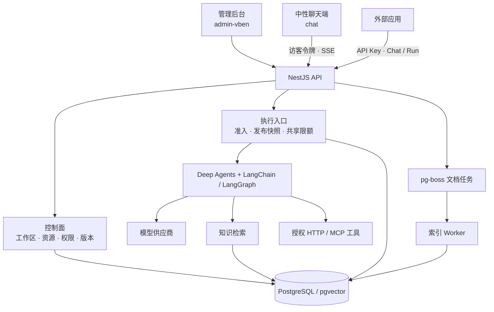

# Agent Studio

**构建、发布和运行通用 AI Agent 的开源平台。** 在管理后台配置模型、Prompt、Skill、Tool / MCP 与知识库，将它们组合成 Agent 的发布版本，再通过聊天端或 API 提供服务。运行时使用 Deep Agents、LangChain 与 LangGraph；平台负责工作区隔离、版本快照、能力授权、执行限额和追踪。

[在线体验](https://hexu.7410000.xyz/) · [独立展示项目 Demo Hub](https://github.com/chaobin0701/demo-hub) · [系统架构](#系统架构) · [MIT 许可](LICENSE)

## 后台预览


本地示例工作区的管理首页集中呈现常用资源、最近编辑的 Agent、执行情况和知识库处理状态。

## 从配置到一次运行

Agent Studio 将 Agent 的**配置管理**与**任务执行**连接起来：

1. 在工作区中创建模型方案、业务 Prompt、Skill、HTTP / MCP Tool 和知识库。
2. 为 Agent 选择这些能力，调试后发布版本。发布版本固定所引用的模型、指导、工具与成员 Agent；后续修改先进入草稿。
3. 通过后台、独立聊天端或接入应用发起对话与任务。服务端检查身份、应用权限和限额，再读取当前生效版本的快照。
4. Deep Agents 在授权范围内调用模型、检索资料或执行工具。结果、引用、公开进度与用量由平台统一返回和记录。

平台不内置商品、订单或某个行业的客服流程。业务系统通过受控 HTTP / MCP 工具连接；[Demo Hub](https://github.com/chaobin0701/demo-hub) 是独立的应用和数据服务，用两个场景展示这种接入方式。

## 系统架构



| 层 | 职责 | 对应实现 |
| --- | --- | --- |
| 管理控制面 | 工作区、成员权限，以及 Agent、Prompt、Skill、Tool、模型和知识库的草稿、发布与历史版本 | `admin-vben/`、`server/src/agent-management/`、`server/src/workspaces/` |
| 接入层 | 管理员操作、平台 API Key、网站访客令牌、会话和独立 Run 的准入与用量限制 | `server/src/integrations/`、`server/src/chat/`、`server/src/executions/` |
| 执行层 | 固定发布快照与能力范围，执行单 Agent / 多 Agent 任务，控制模型、工具和 Token 预算 | `server/src/ai/runtime/`、`server/src/ai/deep-agents/` |
| 能力层 | 模型适配、知识检索、Skill 加载与受控 HTTP / MCP 工具调用 | `server/src/ai/`、`server/src/documents/`、`server/src/tool-management/` |
| 数据与后台任务 | 持久化配置、会话、索引和执行记录；异步解析文档、构建索引 | `server/migrations/`、`server/src/worker.ts` |

**Chat 与 Run 共享同一执行内核。** 对话入口管理会话与历史；独立 Run 可直接提交任务，不必创建会话。两者最终都进入 `AgentExecutionService → DeepAgentExecutionService`，由发布快照决定可用模型、知识范围和工具。管理后台和中性聊天端复用 `packages/chat-ui/` 的会话交互，输出规范在 `packages/output-contract/` 中共享。

## 核心能力

| 能力 | 实现方式 |
| --- | --- |
| 资源发布与回滚 | 草稿、不可变发布版本和当前生效指针；Agent 固定 Prompt、模型、Tool、Skill 及成员版本，历史可追溯 |
| 单 Agent 与协作 | Deep Agents 执行通用任务；入口 Agent 可调用已授权的成员 Agent，并共享执行期限与预算 |
| 文档知识库 | Markdown、PDF、DOCX 解析与异步索引；支持全文、向量和混合检索，索引版本可切换 |
| 外部能力 | 管理 HTTP 工具和远程 MCP 连接；发现工具、审核契约、测试并发布后，再授权给 Agent |
| 多种接入方式 | 管理后台调试、中性聊天端、带会话的 Chat API、无会话的 Run API；支持 SSE 流式结果 |
| 隔离与治理 | 工作区权限与 PostgreSQL RLS、应用与访客身份隔离、工具网络边界、执行限额和审计 |
| 结果与追踪 | 文本、结构化输出、引用和文件产物；执行记录可关联可选的本地 Phoenix 追踪 |

Agent 发布时选择的是**工具版本**，运行请求再固定该版本和当前授权。模型只获得可用工具的名称、说明与参数 Schema；服务端负责参数校验、凭据、网络访问策略、调用预算及结果记录。MCP 发现新工具不会自动给予 Agent 权限。知识检索同样只访问本次快照允许的知识库和索引，并在读取时检查文档状态。

详细规则见[工具管理](docs/tool-management.md)、[知识库管理](docs/knowledge-management.md)和[工作区隔离](docs/workspaces.md)。

## 技术栈与仓库结构

| 部分 | 技术 |
| --- | --- |
| 管理后台 | Vue 3、Vben、Element Plus、Vite |
| 中性聊天端 | Vue 3、Element Plus、共享 `chat-ui` 组件 |
| API 与执行 | Node.js、TypeScript、NestJS、Deep Agents、LangChain / LangGraph |
| 存储与任务 | PostgreSQL、pgvector、pg-boss |
| 外部能力 | HTTP Tool、MCP Streamable HTTP、SSE |

| 目录 | 职责 |
| --- | --- |
| `admin-vben/` | 唯一管理后台；保留 Vben 上游包和许可 |
| `chat/` | 与具体业务无关的对外聊天端，按接入应用 ID 启动 |
| `packages/chat-ui/` | 后台与聊天端共用的会话组件和客户端状态 |
| `packages/output-contract/` | 前后端共享的输出规范 |
| `server/src/` | API、资源管理、执行服务、工具与知识库实现 |
| `server/migrations/` | 数据库结构与约束迁移 |
| `docs/` | 设计决策、接口与能力的详细说明 |
| `deploy/showcase/` | Agent Studio 与独立 Demo Hub 的同机部署示例 |

## 本地启动

需要 Node.js 22.18+ 或 24.12+、pnpm 11+ 和 Docker Compose。首次运行时，`setup` 安装依赖并生成独立随机密钥的本地 `.env`；已有配置不会被覆盖。

```sh
npm run setup
docker compose up -d postgres
npm run db:migrate
npm --prefix server run build
npm run admin:bootstrap       # 交互创建首个管理员
npm run dev
```

| 服务 | 默认地址 |
| --- | --- |
| 管理后台 | `http://localhost:8085` |
| 中性聊天端 | `http://localhost:8852` |
| API | `http://localhost:3020` |
| PostgreSQL | 本机端口 `5437` |

登录后台后，先配置供应商连接与模型方案，创建并发布 Prompt，再创建 Agent、调试和发布。如需对外聊天，创建接入应用、选择已发布 Agent，并配置允许的网站 Origin；访问 `http://localhost:8852/?app=应用UUID`。应用 ID 是公开标识，浏览器使用服务端签发的短期访客令牌，不应填写平台 API Key。完整接入方式见[接入与权限](docs/integration-access.md)及[独立 Agent Run](docs/generic-agent-runs.md)。

项目不提供默认管理员、模型密钥或业务数据。本地数据库与来源项目隔离；不会连接来源数据库，也不会恢复其演示用户、密钥或上传文件。

## 验证与部署

```sh
npm run typecheck
npm run build
npm test
```

PostgreSQL 集成测试需显式配置 `TEST_DATABASE_URL`，并使用临时 schema；普通测试不会连接业务数据库。

正式部署可参考 `compose.production.yml`：先审查本地 `.env`，将 `ALLOWED_ORIGINS` 设为实际入口，并仅在可信反向代理之后配置 `TRUST_PROXY=1`。默认 ingress 绑定 `127.0.0.1:8075`，API、Worker 和 PostgreSQL 不直接对外暴露。首次生产部署后，在生产容器内运行 `npm run admin:bootstrap` 创建管理员。

Agent Studio 与独立 Demo Hub 同机部署的生产实例、备份与回滚操作见 [展示环境手册](deploy/showcase/README.md)。

## 延伸阅读

- [平台架构设计与演进记录](docs/generic-agent-platform.md)
- [资源生命周期与依赖保护](docs/resource-lifecycle.md)
- [知识库与检索策略](docs/knowledge-management.md)
- [HTTP / MCP 工具管理](docs/tool-management.md)
- [独立 Agent Run 接口](docs/generic-agent-runs.md)
- [安全策略](docs/security-policy.md)

项目代码采用 [MIT 许可](LICENSE)。来源和上游许可见 [SOURCE.md](SOURCE.md)；`admin-vben/` 等第三方内容保留各自的许可。
