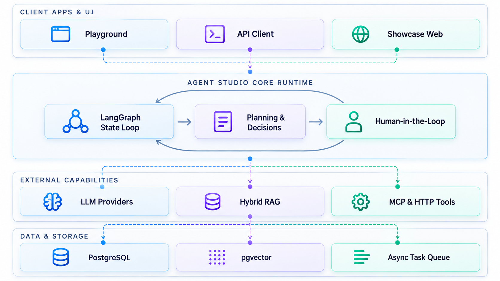

# Agent Studio

**An enterprise-grade open-source platform for orchestrating, publishing, and running general-purpose AI Agents.**

Manage model plans, business prompts, reusable skills, knowledge bases, and external tools within a unified workspace. Safely deploy autonomous agents and connect them to web applications and downstream APIs through standardized interfaces.

[English](README_EN.md) · [简体中文](README.md) · [Live Demo](https://hexu.7410000.xyz/) · [Official Showcase](https://github.com/chaobin0701/agent-studio-showcase)

---

## Core Design Principles

Agent Studio is built on three foundational principles designed to solve the challenges of uncertainty, coupling, and auditability in production AI applications:

1. **Immutable Versioned Releases**: Drafts evolve freely, but releases remain strictly frozen. Publishing an Agent creates an immutable snapshot locking the exact versions and hashes of its prompt, model configuration, knowledge base, and tools. Production requests always execute against deterministic snapshots, ensuring full auditability, reproducible results, and instant, zero-loss rollbacks.
2. **Total Decoupling of Core Engine and Business Domains**: Agent Studio focuses solely on cognitive planning, multi-step reasoning, state graphs, and security governance. It never couples with proprietary domain data. Business assets and services connect externally via standard **HTTP Tools** or **Model Context Protocol (MCP)** endpoints.
3. **True Human-in-the-Loop (HITL) Collaboration**: When an agent requires clarification on ambiguous intent or encounters sensitive operations, it suspends execution and delivers structured choices or approval requests to the frontend. Powered by persistent state checkpoints, the agent cleanly resumes the original task once the user responds.

---

## System Architecture & Execution Model

Agent Studio connects asset orchestration, stateful execution, and external consumer applications into an end-to-end production loop:



---

## Core Capabilities & Highlights

### 1. Atomic Asset Decoupling & Immutable Releases
* **Atomic Assets**: Model Providers, Prompts, Knowledge Bases, Tools (HTTP & MCP), and Skills are managed as first-class, independent entities.
* **Release Snapshots**: Supports multi-version coexistence and visual diffing. Publishing an agent freezes dependency hashes, guaranteeing that rollbacks never corrupt historical run records or audit traces.

### 2. Deep Agents / LangGraph State Graph Engine
* **Unified Dual-Mode Engine**: Immediate conversations (Chat) and long-running asynchronous tasks (Run) share the same underlying state-graph runtime, equipped with step limits, global token budgets, and timeout protection.
* **Guaranteed Structured Output**: Enforces output contracts via JSON Schema with a dual-view editor (Field Tree & Raw Source), ensuring agents return deterministic data structures required by downstream systems.

### 3. Human-in-the-Loop Collaboration
* **Proactive Clarification (`ask_user`)**: When encountering ambiguous parameters or decision branches, the agent pauses to present structured options and input prompts, dynamically taking over the chat composer.
* **Pre-Execution Approval**: For sensitive tools (e.g., updating orders, deleting resources, or reading private data), actions can require explicit user approval in the UI before execution occurs.
* **Resilient Resumption**: Execution state is durably saved in PostgreSQL checkpoints. Even across browser refreshes or network reconnections, pending interactions resume without re-running earlier steps.

### 4. Enterprise-Grade Hybrid RAG
* **Multi-Retrieval Pipeline**: Uploaded documents are parsed, chunked, and indexed asynchronously by dedicated background workers. Searches combine PostgreSQL full-text search with pgvector vector embeddings, fused and reranked using Reciprocal Rank Fusion (RRF).
* **Verifiable Citations**: Responses retain exact, verifiable source chunks. Indexes are version-isolated, allowing older agent releases to pin stable historical indexes while newer updates evolve.

### 5. Open Tooling Ecosystem: HTTP & Model Context Protocol (MCP)
* **Native Model Context Protocol**: Connects directly to remote Streamable HTTP MCP endpoints with contract discovery and tool mounting.
* **Enterprise Security Boundaries**: Built-in egress IP allowlists, encrypted credential references, timeout breakers, and parameter validation prevent internal network probing and credential leaks.

### 6. Multi-Tenant Governance & Full-Stack Observability
* **Workspace Isolation**: Data isolation enforced at the database level via PostgreSQL Row-Level Security (RLS), with fine-grained RBAC permissions down to individual asset operations.
* **Streaming & Tracing**: Native Server-Sent Events (SSE) stream tokens and reasoning thoughts in real time. Explicit OpenInference / OpenTelemetry instrumentation supports LangSmith execution trees, usage and latency inspection; content tracing is separately configured and disabled by default. See [LangSmith tracing](docs/langsmith-tracing.md).

---

## Admin Console Overview


A comprehensive enterprise management console built with Vue 3, Vite, and Tailwind CSS. It covers the entire lifecycle from provider setup, prompt engineering, knowledge base curation, to visual release diffing and standalone Playground testing.

---

## Quick Start

### Prerequisites
* **Node.js**: `>= 22.18` or `>= 24.12`
* **Package Manager**: `pnpm >= 10.0.0`
* **Containers**: Docker & Docker Compose (for PostgreSQL with the pgvector extension)

### Local Setup & Launch

1. **Install workspace dependencies and initialize environment**:
   ```sh
   npm run setup
   ```
   *This checks system dependencies and creates a `.env` file with secure, randomly generated secrets.*

2. **Start the database container**:
   ```sh
   docker compose up -d postgres
   ```

3. **Run database migrations**:
   ```sh
   npm run db:migrate
   ```

4. **Build core backend modules**:
   ```sh
   npm --prefix server run build
   ```

5. **Bootstrap the initial administrator**:
   ```sh
   npm run admin:bootstrap
   ```
   *Follow the CLI prompts to configure the initial administrator email, username, and password.*

6. **Start development servers**:
   ```sh
   npm run dev
   ```

Once started:
* **Admin Console**: `http://localhost:8085`
* **API Service**: `http://localhost:3020`
* **PostgreSQL Port**: `localhost:5437`

---

## Build Your First Agent in 3 Steps

Log in to the admin console and follow three simple steps to publish and connect an agent:

1. **Configure Model Providers**: Go to **Model Management** ➔ Connect any OpenAI-compatible provider (e.g., DeepSeek, OpenAI, Ollama) and configure a default model plan.
2. **Orchestrate & Release**:
   * Author a system instruction under **Prompts**;
   * Attach required documents in **Knowledge** or external services in **Tools / MCP**;
   * Navigate to **Agents** ➔ Create a new Agent, assemble the assets above, configure input/output schemas, and click **Publish** to create Release Version 1.
3. **Test & Integrate**:
   * Click **Playground** next to the agent to test reasoning chains, tool execution, and interaction cards in a standalone task interface;
   * Under **Applications**, create a client app entry and configure allowed origins to generate secure, short-lived tokens for frontend integration.

---

## Repository Structure

The project is structured as a clear, modular Monorepo:

```text
agent-studio/
├── admin-vben/             # Management console frontend (Vue 3 / Vite / Vben Admin)
│   └── apps/web-ele/       # Element Plus based admin application and playground
├── server/                 # Core backend runtime service (NestJS / TypeScript)
│   ├── src/ai/             # Agent runtime, LangGraph state engine, MCP client, and model orchestration
│   ├── src/knowledge/      # Hybrid RAG search, vector storage, and chunking pipeline
│   ├── src/tools/          # HTTP Tool and dynamic MCP tool governance
│   └── src/admin/          # Workspaces, users, RBAC, and client application auth
├── packages/               # Shared cross-cutting packages
│   ├── chat-ui/            # Shared modern chat and interaction card UI components
│   └── output-contract/    # Structured output JSON Schema validation and editor core
└── deploy/                 # Docker Compose and production showcase deployment configurations
```

---

## Ecosystem & Best Practices

To demonstrate how the platform keeps its core generic while powering real-world applications, we open-sourced a companion showcase project:

* **[Agent Studio Showcase](https://github.com/chaobin0701/agent-studio-showcase)**:
  Built with Next.js 16 and React 19, demonstrating two complete end-to-end scenarios:
  * **Robot Assistant**: Demonstrates troubleshooting via knowledge RAG, cleaning log analysis, and weather tool integration in a single conversation.
  * **Outdoor Equipment Advisor (Contoso Outdoor)**: Demonstrates retail consultation, technical manual lookups, interactive clarification (`ask_user`), and user approvals for sensitive purchase history queries.

---

## Verification & Testing

```sh
npm run typecheck    # Workspace-wide TypeScript type validation
npm run build        # Production builds for server and frontend packages
npm test             # Run complete automated test suite (130+ unit & integration tests)
```

---

## License

This repository is licensed under the [MIT License](LICENSE). Third-party dependencies and notices are documented in [SOURCE.md](SOURCE.md).
